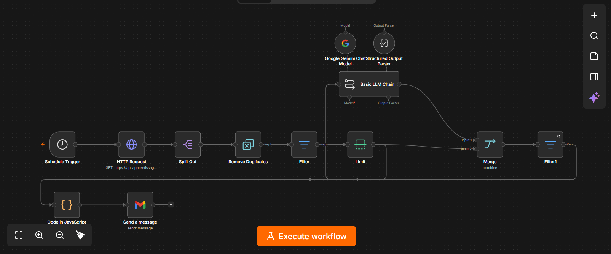
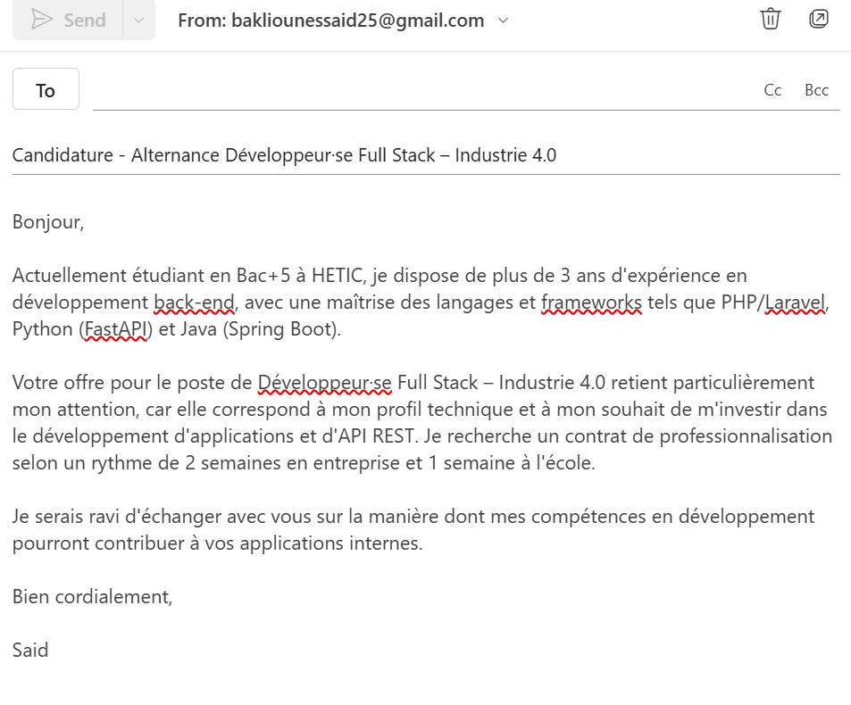
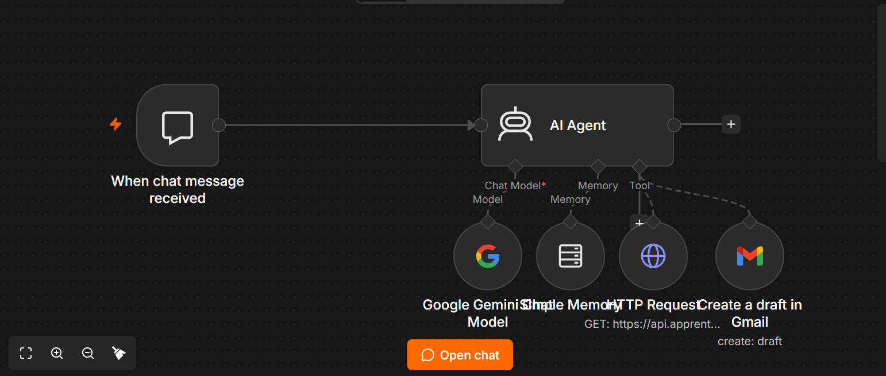

# Automatisation de ma recherche d'alternance avec n8n et l'IA

Chaque matin, je cherchais des offres d'alternance, je lisais chaque annonce pour savoir si elle correspondait à mon profil, puis je postulais. Ce projet automatise cette routine avec **n8n**, l'**API La Bonne Alternance** et un **LLM (Google Gemini)**.

Il contient deux workflows complémentaires :

1. **Un workflow automatique** qui, chaque matin, récupère les nouvelles offres, les fait noter par une IA selon mon profil et m'envoie par email uniquement les plus pertinentes.
2. **Un agent IA conversationnel** à qui je peux demander des offres en langage naturel, et qui sait préparer un brouillon de candidature dans Gmail.



---

## 1. Workflow « Tri des offres du matin »

```
Schedule (8h) → HTTP Request (API La Bonne Alternance) → Split Out
  → Remove Duplicates → Filter (contrat de professionnalisation) → Limit
  → Basic LLM Chain (Gemini + Structured Output Parser) → Merge
  → Filter (score ≥ 7) → Code (mise en forme HTML) → Gmail
```

**Fonctionnement**

- Les offres sont récupérées via l'API officielle La Bonne Alternance (filtrées par code métier ROME, zone géographique et niveau de diplôme).
- Un premier filtre déterministe ne garde que les offres acceptant le contrat de professionnalisation. Ce tri gratuit et instantané évite de consommer des appels IA inutiles.
- Le nœud Remove Duplicates mémorise les offres déjà traitées d'une exécution à l'autre, pour ne jamais recevoir deux fois la même.
- Le LLM évalue chaque offre selon mon profil et renvoie une réponse **structurée en JSON** (score, points forts, points faibles, verdict) grâce à un Structured Output Parser.
- Un nœud Merge recolle l'analyse de l'IA à l'offre d'origine, puis seules les offres notées 7/10 ou plus sont envoyées, triées par score, dans un email HTML.



## 2. Agent « Assistant de recherche d'alternance »

```
Chat Trigger → AI Agent
                ├─ Modèle : Google Gemini
                ├─ Mémoire : Simple Memory
                ├─ Outil 1 : recherche d'offres (HTTP Request Tool)
                └─ Outil 2 : création de brouillon Gmail
```

**Fonctionnement**

- L'agent choisit lui-même les paramètres de recherche (coordonnées GPS de la ville, code métier) à partir d'une demande en langage naturel, par exemple : « Trouve-moi des alternances en développement à Lyon ».
- La mémoire lui permet de suivre la conversation (« Et à Paris ? »).
- Il sélectionne une offre selon des **critères explicites et priorisés**, justifie son choix à partir des données, puis peut préparer un brouillon de candidature.
- Par conception, l'outil Gmail ne crée que des **brouillons** : rien n'est envoyé sans relecture humaine.



---

## Stack technique

- **n8n** (auto-hébergé via Docker)
- **API La Bonne Alternance** (offres d'alternance en temps réel)
- **Google Gemini** via l'API Google AI Studio
- **Gmail API** (OAuth 2.0)
- JavaScript (nœud Code)

## Lancer le projet

1. Démarrer n8n :
   ```bash
   docker compose up -d
   ```
   puis ouvrir http://localhost:5678
2. Importer les workflows du dossier `workflows/` (menu ⋯ → Import from File).
3. Recréer les credentials, qui ne sont pas incluses dans les exports :
   - **Header Auth** : clé API La Bonne Alternance (`Authorization: Bearer <clé>`)
   - **Google Gemini** : clé API Google AI Studio
   - **Gmail OAuth2** : Client ID et Client Secret d'un projet Google Cloud
4. Remplacer `votre-email@exemple.com` dans le nœud Gmail par votre adresse.
5. Adapter le profil et les critères dans les prompts.

## Difficultés rencontrées et choix techniques

- **Sortie de l'IA non exploitable** : sans contrainte, le modèle renvoyait des formats variables (noms de champs différents, blocs Markdown). Le Structured Output Parser impose un schéma JSON fixe que le reste du workflow peut lire.
- **Perte des données après le LLM** : la sortie du LLM ne contient que l'analyse. Un nœud Merge (combinaison par position) la rattache à l'offre d'origine.
- **Quotas de l'offre gratuite Gemini** : limite de requêtes par jour et par modèle. Solution : un modèle distinct par usage, et Retry On Fail pour les erreurs 429.
- **Fiabilité des décisions de l'agent** : une consigne vague (« l'entreprise la plus adaptée ») le poussait à choisir selon la notoriété. Des critères explicites, priorisés et justifiés par les données ont corrigé ce comportement.
- **Sécurité** : principe du « human in the loop », l'agent prépare et l'humain valide.

## Pistes d'amélioration

- Déploiement sur un serveur pour une exécution indépendante du poste local
- Outil permettant à l'agent de se renseigner sur une entreprise avant de rédiger
- Jeu de tests (évaluations) pour vérifier le comportement de l'agent après chaque modification
